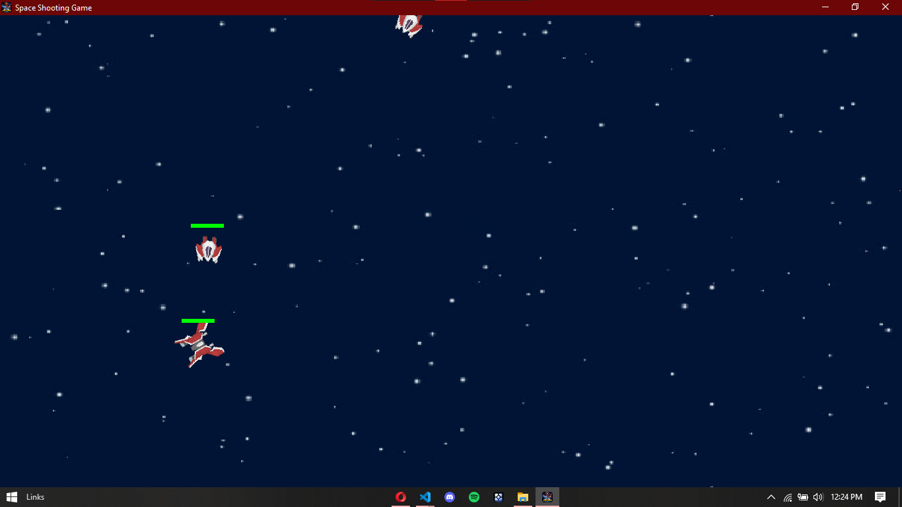

# Multiplayer Space Shooter

A top-down space shooting game made with Pygame, where up to four players fly in the same arena and fight off waves of enemy ships together. The game client runs on your own computer and connects to a small WebSocket server hosted on Render.



**Download (Windows):** see the [Releases](../../releases) page, then run `client.exe`.

> **Note:** The server runs on a free host that sleeps when idle, so the first connection can take up to a minute. The game window opens right away and keeps retrying in the background.

## How to play

| Key / mouse | Action |
|---|---|
| `W` `A` `S` `D` | Move |
| Mouse | Aim (the ship rotates toward the cursor) |
| Left click | Shoot |
| `Esc` | Pause / resume |
| `R` | Restart after Game Over |
| `Q` | Quit |

Enemy ships spawn at the top every few seconds and chase the nearest player. Touching one costs health, and your health bar sits above your ship. When it runs out, it's Game Over.

## How it works

1. When the client starts, it connects to the server over a secure WebSocket (`wss://`) and receives a unique player ID.
2. About 60 times per second, the client sends its own state as JSON: position, health, aim angle, latest bullet and pause status.
3. The server doesn't simulate anything. It relays each message to every other connected player, and each client draws the other players from the data it receives.
4. Enemies are spawned by a client and broadcast to the others, so everyone sees the same ones.
5. The server also keeps a leaderboard in SQLite (`scores.db`) and understands `submit_score` and `get_leaderboard` messages.

## Tech

- Python, Pygame
- `websockets` and `asyncio` (the game loop and the network connection run together using `asyncio.gather`)
- SQLite for the leaderboard
- PyInstaller to package the client as a Windows `.exe`
- Server deployed on Render

## Run it locally

**Server**

```
pip install websockets
python server.py
```

It listens on port 5555 by default. On Render it reads the port from the `PORT` environment variable instead.

**Client**

```
pip install pygame websockets
python client.py
```

For local testing, set `SERVER_URL` near the top of `client.py` to `ws://localhost:5555`. For the hosted server, use `wss://your-service-name.onrender.com` (no port number).

**Build the exe**

```
pip install pyinstaller
python -m PyInstaller client.spec
```

The result appears in `dist/`. If you add new images or sounds, add them to `client.spec` too, or the exe won't find them.

## Deploying the server

The server is a Render **Web Service** with:

- Build command: `pip install -r requirements.txt`
- Start command: `python server.py`
- No environment variables (the server has no secrets)

The server and the client have separate dependencies: the server only needs `websockets`, while the client also needs `pygame`.

## What I learned

- How WebSockets keep a connection open so many players can exchange messages in real time.
- Running a Pygame loop and a network connection side by side with `asyncio`.
- Reconnecting with a short delay, so a sleeping server doesn't get hammered with retries.
- Deploying a server to Render: reading the port from `PORT`, using `wss://`, and keeping a separate `requirements.txt` per part.
- Packaging a game with PyInstaller, including finding bundled assets through `sys._MEIPASS`.
- Using `.gitignore` to keep build output, virtual environments and databases out of the repo.

## Known limitations

- The server only relays messages. Each player's game decides for itself who got hit, so a modified client could cheat.
- Scores are accepted as sent, with no validation.
- The free Render disk is wiped on every restart or redeploy, so the leaderboard resets.
- Four players at most, in a single shared room.
- The `.exe` is Windows only. On other systems, run the client from source.

## Ideas for next steps

- Move enemy spawning and damage to the server, so it is the single source of truth.
- Validate scores, and store them in a database that survives restarts.
- Add a leaderboard screen in the client.
- Support multiple rooms.

## Credits

- Ship and missile sprites: [Kenney](https://kenney.nl) (Space Shooter Extension, CC0)
- Music: add the track title, artist and license here